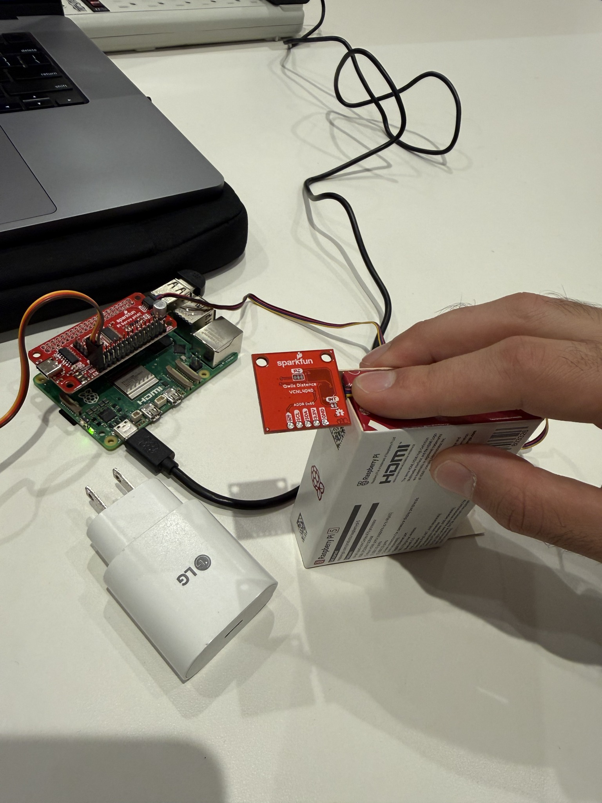
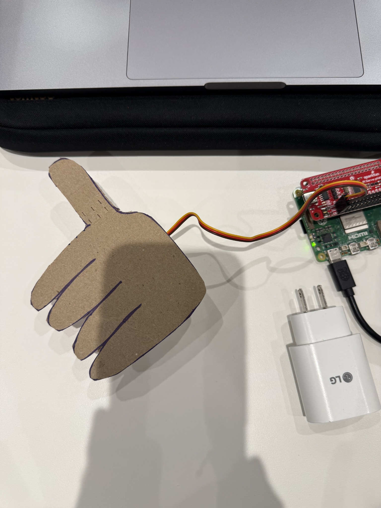

# Lab 4: Ph-UI!!!

**Student:** Jonathan Sharpy  
**Cornell Tech | Developing and Designing Interactive Devices**  
**Project:** WasteWise

---

## Part 1: Sensing and Actuation Exploration

### Sensor and Actuator Testing

Before developing WasteWise, I explored several sensing and actuation components using the Raspberry Pi 5. The tests included capacitive touch sensing, proximity detection, RGB/color sensing, gesture recognition, and servo motor control.

The setup photographs and screenshots of the corresponding terminal outputs are organized in the [Sensor and Actuator Testing Evidence](media/sensor_tests/) folder.

| Component | Test Evidence |
|---|---|
| MPR121 capacitive touch | [Setup](media/sensor_tests/Capacitive_Touch_MPR121_Setup.jpeg) · [Terminal output](media/sensor_tests/Capacitive_Touch_MPR121_Terminal_Output.png) |
| APDS-9960 proximity | [Terminal output](media/sensor_tests/Proximity_APDS9960_Terminal_Output.png) |
| APDS-9960 color/light | [Terminal output](media/sensor_tests/Color_Light_APDS9960_Terminal_Output.png) |
| APDS-9960 gesture | [Terminal output](media/sensor_tests/Gesture_APDS9960_Terminal_Output.png) |
| Servo motor and Servo pHAT | [Setup](media/sensor_tests/Servo_pHAT_Setup.jpeg) · [Terminal output](media/sensor_tests/Servo_Motor_Terminal_Output.png) |

The servo was first tested independently before being incorporated into the WasteWise cardboard prototype.

**Testing observations:**

- **Capacitive touch:** The MPR121 detected touch events on its electrode contacts and displayed the corresponding messages in the terminal.
- **Proximity:** The APDS-9960 proximity readings changed as objects moved closer to or farther from the sensor.
- **Color/light:** The APDS-9960 produced different RGB and light readings when exposed to different surfaces and lighting conditions.
- **Gesture:** The APDS-9960 detected directional hand gestures, including left, right, and up.
- **Servo actuation:** The SparkFun Servo pHAT successfully controlled the servo motor's angular position, demonstrating repeatable physical movement.

These tests helped establish which sensing and actuation capabilities could support the physical interaction concepts explored below.

---

## Physical Interaction Design: Feast Automata

### Five Design Sketches

I explored five dining-related concepts that combine sensing and actuation to create playful or useful physical interactions.

The sketches illustrate different physical arrangements, including the placement of sensors, actuators, and other components relative to the user and dining environment.

**1. WasteWise: Plate Scanner**

A distance sensor observes food remaining on a plate. A servo-driven hand provides a thumbs-up or thumbs-down gesture to communicate feedback about food waste.

**2. CookCue: Food Readiness Assistant**

A color sensor examines the surface appearance of food during cooking. A speaker provides feedback about its appearance or cooking progress. Color alone would not be used to establish food safety.

**3. SpoonSense: Utensil Advisor**

A sensor or user input identifies characteristics of the food, such as temperature or type. A physical indicator recommends an appropriate utensil material.

**4. CleanSwipe: Automatic Utensil Cleaner**

A proximity sensor detects when a utensil enters a tabletop cleaning mechanism. A servo moves a cleaning component across the utensil's surface.

**5. UtensilCarousel: Smart Utensil Selector**

A rotary encoder or joystick allows users to select a dining task or food type. A servo-driven carousel rotates to present the appropriate utensil.

**Five concept sketches:**


### Questions Raised by the Sketches

The five sketches explore different ways to use sensing and physical feedback to improve everyday dining experiences.

The main questions they raise are:

- **WasteWise:** Can a distance sensor reliably distinguish leftover food from an empty plate? Where should it be positioned, and would a physical thumbs-up or thumbs-down gesture effectively communicate food waste?
- **CookCue:** Can food color provide useful information about cooking progress, and how should the device communicate its assessment without implying that color alone guarantees food safety?
- **SpoonSense:** Can temperature and food characteristics help recommend a more comfortable utensil material?
- **CleanSwipe:** How could a compact tabletop mechanism clean a utensil between foods without interrupting the meal? How would it avoid transferring contaminants?
- **UtensilCarousel:** Can a rotating utensil holder make selecting the appropriate utensil more convenient, and how much space would it occupy on the table?

To investigate these questions, I would prototype the physical placement of the sensors, the size and movement of the actuators, and how users interact with each device during a meal.

For WasteWise specifically, I wanted to test whether a simple rotating cardboard hand could provide recognizable feedback before attempting a more complex sensing and actuation system.

---

### Selected Design: WasteWise

I selected **WasteWise**, a device designed to encourage people to reduce food waste by providing immediate physical feedback about leftovers on their plates.

I chose this concept because it addresses an everyday problem while offering a straightforward interaction between sensing and actuation. The intended system uses distance sensing to estimate how much food remains on a plate, then responds with a physical gesture.

My original idea involved two mechanical hands clapping to celebrate minimal food waste. However, I simplified the mechanism to a single rotating hand that could display a thumbs-up or thumbs-down. This reduced the mechanical complexity while preserving the central idea of communicating feedback through physical movement.

For the low-fidelity prototype, I attached a cardboard hand to a servo motor and used a manually triggered rotation to demonstrate the intended interaction. This allowed me to focus on testing the clarity and feasibility of the physical feedback before integrating automatic food detection.

---

### Low-Fidelity Prototype

I constructed a physical WasteWise prototype using a cardboard hand, a micro-servo motor, the SparkFun Pi Servo pHAT, and a Raspberry Pi 5.

The cardboard hand was attached to the servo horn, allowing the motor to rotate the gesture between different orientations.

For this initial prototype, I focused on demonstrating the physical feedback mechanism rather than constructing a complete housing or implementing automatic food detection.

**Prototype photographs**

**1. WasteWise prototype assembly**


**2. Servo horn and cardboard attachment**


**3. Cardboard thumbs-up prototype**


---

### Wizard-of-Oz Demonstration

**[Watch the WasteWise Prototype Demonstration](https://drive.google.com/file/d/12jNM7uuJcP61YKrk7G9qeKD65bir73ut/view?usp=sharing)**

The video demonstrates the intended interaction between detecting leftover food and providing physical feedback.

I first position the distance sensor over a plate containing leftover food. When the sensor is moved over the leftovers, I manually trigger the servo motor by pressing the spacebar on my laptop.

The servo rotates the cardboard hand downward, displaying a thumbs-down gesture to represent food waste.

This is a **Wizard-of-Oz prototype**: the intended sensing interaction is simulated by the operator, while the servo motor's physical movement is real.

---

### Prototype Implementation

I created a cardboard thumbs-up cutout and attached it to the horn of a micro-servo motor connected to the SparkFun Pi Servo pHAT and Raspberry Pi 5.

Using a Python script, I calibrated the servo to rotate between approximately **60° and 150°**. Pressing the spacebar activates the rotation, turning the cardboard thumbs-up into a thumbs-down.

For the Wizard-of-Oz demonstration, I positioned a distance sensor above a plate containing leftover food. When the sensor was positioned over the leftovers, I manually pressed the spacebar to trigger the servo, producing a thumbs-down gesture to represent detected food waste.

The sensing-to-actuation connection was simulated rather than automated. This prototype demonstrates the intended physical interaction, while automatic leftover detection and quantitative food-waste estimation remain goals for future development.

**Prototype code:** [wastewise_demo.py](wastewise_demo.py)

---

## AI Assistance Acknowledgment

I used ChatGPT as a technical and documentation assistant during this lab.

AI assistance included guidance with Raspberry Pi setup, Python environment configuration, sensor and servo testing, troubleshooting, and development of the keyboard-controlled servo demonstration script.

I also used ChatGPT to help organize and refine my written documentation and to guide the creation of my visual references based on my five original dining concepts.

The concept selection, design decisions, cardboard prototype construction, hardware testing, servo calibration, demonstration recording, and final design sketches were completed by me. The Wizard-of-Oz demonstration and its simulated sensing behavior are explicitly identified in the documentation.

---

<details>
<summary><strong>Original Lab 4 Part 2 Instructions (Reference)</strong></summary>

## Part 2

Following exploration and reflection from Part 1, complete the "looks like," "works like" and "acts like" prototypes for your design, reiterated below.

---

### Part E

#### Build & Integrate: Sensing + Actuation

For Part 2, build the Feast Automata interaction you developed in Part D by connecting sensing/input to physical actuation.

**Your prototype should:**
- Use at least one sensing or input device.
- Use servo-based physical actuation.
- Connect sensing and actuation into a meaningful interaction around eating, drinking, cooking, serving, or sharing food.
- Additional inputs, displays, LEDs, buttons, or other outputs are optional extensions.

**Document your system with:**
- Code for your sensing + actuation prototype
- Photos and/or video of the working prototype in action
- A simple interaction diagram or sketch showing how sensing and actuation are connected
- Written reflection: What did you learn about connecting sensing, movement, and physical form? What was fun, surprising, or challenging?

**Questions to consider:**
- How does your chosen sensor or input shape the physical response?
- How does the physical arrangement of the sensor and actuator change the interaction?
- What thresholds, timing, or movement patterns make the interaction feel clear or playful?
- What changes when you adjust the sensor placement or servo motion?

Iterate on the sensing, movement, and physical form, and document what you discover.

See encoder_accel_servo_dashboard.py in the Lab 4 folder for an optional example of chaining together three devices.

**`Lab 4/encoder_accel_servo_dashboard.py`**

#### Example Application: Windmill Coaster

Now that you have explored both sensing and actuation, here is a simple example that combines the two.

The **Windmill Coaster** uses a Qwiic distance/proximity sensor to detect when a cup is placed on a coaster. When the cup is detected, a servo motor animates a small windmill by sweeping it back and forth, turning an ordinary action during drinking into a playful physical interaction.

<p align="center">
    
</p>


This example demonstrates a simple interaction pipeline:

**cup placed → distance sensor detects cup → servo actuates windmill**

Connect the Qwiic distance sensor to the Pi and connect the servo to Channel 0 of the Servo pHAT. Make sure the Servo pHAT is powered through its USB-C connection.

Run the example script:

```bash
python windmill_coaster.py
```

The script continuously reads the proximity value from the distance sensor. When the value passes a threshold, the servo begins animating the windmill. When the cup is removed, the servo stops and returns to its resting position.

You may need to adjust `CUP_THRESHOLD` in [`windmill_coaster.py`](windmill_coaster.py) depending on the size of your cup and the physical placement of the sensor. You can run `qwiic_distance.py` first to compare readings with and without a cup.

Use this example as a starting point. Change the sensor, movement, physical form, or dining interaction to create your own Feast Automata variation.

#### Optional Extensions

The following examples are optional resources if you want to add more inputs or outputs to your prototype.

##### Using Multiple Qwiic Buttons: Changing I2C Address (Physically & Digitally)

If you want to use more than one Qwiic Button in your project, you must give each button a unique I2C address. There are two ways to do this:

##### 1. Physically: Soldering Address Jumpers

On the back of the Qwiic Button, you'll find four solder jumpers labeled A0, A1, A2, and A3. By bridging these with solder, you change the I2C address. Only one button on the chain can use the default address (0x6F).

**Address Table:**

| A3 | A2 | A1 | A0 | Address (hex) |
|----|----|----|----|---------------|
|  0 |  0 |  0 |  0 |    0x6F       |
|  0 |  0 |  0 |  1 |    0x6E       |
|  0 |  0 |  1 |  0 |    0x6D       |
|  0 |  0 |  1 |  1 |    0x6C       |
|  0 |  1 |  0 |  0 |    0x6B       |
|  0 |  1 |  0 |  1 |    0x6A       |
|  0 |  1 |  1 |  0 |    0x69       |
|  0 |  1 |  1 |  1 |    0x68       |
|  1 |  0 |  0 |  0 |    0x67       |
| ...| ...| ...| ... |     ...      |

For example, if you solder A0 closed (leave A1, A2, A3 open), the address becomes 0x6E.

**Soldering Tips:**
- Use a small amount of solder to bridge the pads for the jumper you want to close.
- Only one jumper needs to be closed for each address change (see table above).
- Power cycle the button after changing the jumper.

##### 2. Digitally: Using Software to Change Address

You can also change the address in software (temporarily or permanently) using the example script `qwiic_button_ex6_changeI2CAddress.py` in the Lab 4 folder. This is useful if you want to reassign addresses without soldering.

Run the script and follow the prompts:
```bash
python qwiic_button_ex6_changeI2CAddress.py
```
Enter the new address (e.g., 5B for 0x5B) when prompted. Power cycle the button after changing the address.

**Note:** The software method is less foolproof and you need to make sure to keep track of which button has which address!


##### Using Multiple Buttons in Code

After setting unique addresses, you can use multiple buttons in your script. See these example scripts in the Lab 4 folder:

- **`qwiic_1_button.py`**: Basic example for reading a single Qwiic Button (default address 0x6F). Run with:
	```bash
	python qwiic_1_button.py
	```

- **`qwiic_button_led_demo.py`**: Demonstrates using two Qwiic Buttons at different addresses (e.g., 0x6F and 0x6E) and controlling their LEDs. Button 1 toggles its own LED; Button 2 toggles both LEDs. Run with:
	```bash
	python qwiic_button_led_demo.py
	```

Here is a minimal code example for two buttons:
```python
import qwiic_button

# Default button (0x6F)
button1 = qwiic_button.QwiicButton()
# Button with A0 soldered (0x6E)
button2 = qwiic_button.QwiicButton(0x6E)

button1.begin()
button2.begin()

while True:
		if button1.is_button_pressed():
				print("Button 1 pressed!")
		if button2.is_button_pressed():
				print("Button 2 pressed!")
```

For more details, see the [Qwiic Button Hookup Guide](https://learn.sparkfun.com/tutorials/qwiic-button-hookup-guide/all#i2c-address).

---

##### PCF8574 GPIO Expander: Add More Pins Over I²C

Sometimes your Pi’s header GPIO pins are already full (e.g., with a display or HAT). That’s where an I²C GPIO expander comes in handy.

We use the Adafruit PCF8574 I²C GPIO Expander, which gives you 8 extra digital pins over I²C. It’s a great way to prototype with LEDs, buttons, or other components on the breadboard without worrying about pin conflicts—similar to how Arduino users often expand their pinouts when prototyping physical interactions.

**Why is this useful?**
- You only need two wires (I²C: SDA + SCL) to unlock 8 extra GPIOs.
- It integrates smoothly with CircuitPython and Blinka.
- It allows a clean prototyping workflow when the Pi’s 40-pin header is already occupied by displays, HATs, or sensors.
- Makes breadboard setups feel more like an Arduino-style prototyping environment where it’s easy to wire up interaction elements.

**Demo Script:** `Lab 4/gpio_expander.py`

<p align="center">
    
</p>

We connected 8 LEDs (through 220 Ω resistors) to the expander and ran a little light show. The script cycles through three patterns:
- Chase (one LED at a time, left to right)
- Knight Rider (back-and-forth sweep)
- Disco (random blink chaos)

Every few runs, the script swaps to the next pattern automatically:
```bash
python gpio_expander.py
```

This is a playful way to visualize how the expander works, but the same technique applies if you wanted to prototype buttons, switches, or other interaction elements. It’s a lightweight, flexible addition to your prototyping toolkit.

---


---

---

### Part F

### Final Documentation

Document all the prototypes and iterations you have designed and worked on! Again, deliverables for this lab are writings, sketches, photos, and videos that show what your prototype:
* "Looks like": shows how the device should look, feel, sit, weigh, etc.
* "Works like": shows what the device can do
* "Acts like": shows how a person would interact with the device

---

## Deliverables \& Submission for Lab 4

The deliverables for this lab are, writings, sketches, photos, and videos that show what your prototype:
* "Looks like": shows how the device should look, feel, sit, weigh, etc.
* "Works like": shows what the device can do.
* "Acts like": shows how a person would interact with the device.

For submission, the readme.md page for this lab should be edited to include the work you have done:
* Upload any materials that explain what you did, into your lab 4 repository, and link them in your lab 4 readme.md.
* Link your Lab 4 readme.md in your main Interactive-Lab-Hub readme.md. 
* Labs are due on Mondays, make sure to submit your Lab 4 readme.md to Canvas.

</details>

# Part 2: WasteWise | Build & Integrate

## Part E: Sensing + Actuation

### 1. Project Overview

**WasteWise** is a physical feedback prototype designed to encourage awareness of leftover food. The concept uses a proximity sensor to detect an object in a dining area and a servo-driven cardboard hand to communicate a positive or negative response.

For Lab 4a, I built a low-fidelity cardboard prototype and used a Wizard-of-Oz interaction in which pressing the spacebar manually controlled the servo. For Lab 4b, I connected the proximity sensor directly to the servo in Python, replacing the simulated input with automatic sensing.

The completed prototype demonstrates a simple interaction:

**Object detected → sensor reading crosses threshold → cardboard thumb rotates downward**

**Object removed → sensor reading returns below threshold → cardboard thumb rotates upward**

The current implementation detects proximity, not food type, food quantity, or actual waste. It is intended as a proof of concept for physical feedback during a dining interaction.

---

### 2. Physical Prototype: Looks Like

The prototype uses a Raspberry Pi, SparkFun Pi Servo pHAT, SparkFun Qwiic VCNL4040 proximity sensor, and a small servo motor with a hand-cut cardboard thumb attached.

I kept the cardboard hand from Lab 4a and adjusted its resting angle so the available servo rotation produces a recognizable change between positive and negative feedback.

For the final demonstration, I used the original Raspberry Pi packaging box as a sliding support for the sensor. This helped keep the sensor at a more consistent height while moving it across the table. A wall charger represented an object or leftover food in the detection area.

**Sliding sensor setup**



**Cardboard thumb actuator**



This is still a low-fidelity physical prototype rather than a finished product enclosure. The main goal was to test the relationship between sensor placement, object detection, and visible movement.

---

### 3. System Implementation: Works Like

#### Hardware

| Component | Purpose |
|---|---|
| Raspberry Pi | Runs the sensing and actuation code |
| SparkFun Qwiic VCNL4040 | Measures reflected infrared proximity |
| SparkFun Pi Servo pHAT | Controls the servo over I²C |
| Servo motor, Channel 0 | Rotates the cardboard hand |
| Cardboard hand | Provides visible positive/negative feedback |
| Raspberry Pi packaging box | Supports the sensor during the sliding demonstration |
| Wall charger | Acts as a physical stand-in for food |

The proximity sensor connects to the Servo pHAT through the Qwiic interface. The servo connects to Channel 0 of the pHAT, which has its own power connection.

I verified that both devices were detected on the Raspberry Pi's I²C bus and tested the proximity sensor independently before integrating the two components.

#### Software

The integrated implementation is available here:

**[View `wastewise_integrated.py`](wastewise_integrated.py)**

The original Wizard-of-Oz implementation is preserved here:

**[View `wastewise_demo.py`](wastewise_demo.py)**

The integrated Python script:

1. Initializes the proximity sensor and servo controller.
2. Continuously reads proximity values.
3. Compares readings against calibrated detection and clearing thresholds.
4. Moves the servo smoothly when the detected state changes.
5. Maintains the current position until the opposite threshold is crossed.

This prevents the servo from repeatedly moving while the sensor remains in the same state.

#### Interaction Diagram

```text
Object enters sensing area
            |
            v
  VCNL4040 proximity sensor
            |
            v
      Raspberry Pi
   Read proximity value
            |
            v
  Compare against thresholds
            |
      +-----+-----+
      |           |
  >= 200       <= 180
      |           |
      v           v
  Detect       Clear
   object      object
      |           |
      v           v
  Servo pHAT controls
    servo on Channel 0
      |           |
      v           v
  150 degrees  60 degrees
      |           |
      v           v
  Negative     Positive
   feedback     feedback
```

The two different thresholds create a small buffer, or *hysteresis*, so the actuator does not constantly switch states when readings fluctuate near the boundary.

---

### 4. Testing and Calibration

I first tested the VCNL4040 separately using the provided `qwiic_distance.py` example. Its readings changed as I moved an object closer to and farther from the sensor, confirming that it could detect proximity changes.

Next, I combined the sensor with the working servo code. The first integrated demonstration used a hand moving into and out of the sensor's range. The cardboard hand successfully changed positions automatically, without a keyboard trigger.

**Sensor-to-servo integration video**

[▶ Watch WasteWise Sensor + Servo Integration](https://drive.google.com/file/d/1JBsq2s2rKu3daiEcl63KQPL7mwMCYMQA/view?usp=sharing)

#### Final Physical Arrangement

For the dining-context demonstration, I positioned the proximity sensor on the Raspberry Pi packaging box and slid the assembly across the tabletop. I used a wall charger as a stand-in for food, allowing me to test the interaction with a consistent physical object.

During calibration, I observed readings around 180–200 in the normal sliding region, with higher readings as the sensor passed over the object. In one exploratory test, readings increased dramatically when the object was very close to the sensor.

After several adjustments, I selected the following settings:

| Parameter | Final setting |
|---|---|
| Approximate baseline | 180 |
| Object detection threshold | 200 or higher |
| Object clearing threshold | 180 or lower |
| Positive-feedback servo position | 60° |
| Negative-feedback servo position | 150° |
| Servo movement increment | 2° |
| Delay between movement increments | 0.03 seconds |
| Sensor polling interval | 0.2 seconds |

The final settings were selected through physical testing rather than assuming a fixed sensor-to-object distance.

**Final WasteWise proxy demonstration**

[▶ Watch WasteWise Final Proxy Demonstration](https://drive.google.com/file/d/1SIt6MwPu6vNU7oEGK583mtMcpYT8IZJW/view?usp=sharing)

In this demonstration, the sensor responds to the wall charger as it enters the sensing region, triggering the cardboard hand to rotate toward negative feedback. When the object is no longer detected, the hand returns toward positive feedback.

Because the object is a wall charger rather than actual food, this test validates the sensing-to-actuation interaction, not the ability to identify or quantify leftover food.

---

### 5. User Interaction: Acts Like

In the intended dining interaction, WasteWise would be positioned near a plate or food-return area. When leftover food enters the detection region, the system would provide an immediate physical response through the cardboard thumb.

The user does not need to press a button or manually activate the feedback. The sensing and response occur automatically.

The thumb is deliberately simple and expressive. Rather than displaying a numerical measurement, the prototype communicates its state through physical movement, making the feedback visible at a glance.

The current demonstration simulates the object-detection stage of that experience. A more developed version would need a stable mount, calibration for actual plates and food, and a more reliable method of distinguishing leftovers from the plate or surrounding objects.

---

## Part F: Final Documentation and Reflection

### 6. What I Learned

**How does the chosen sensor shape the physical response?**

The proximity sensor converts the presence of a nearby object into a numerical reading. I used that reading to determine when the servo should change positions. This creates a direct connection between sensing and physical movement, but it also means the interaction depends heavily on sensor placement and threshold selection.

**How does the physical arrangement change the interaction?**

The sensor's position and height made a noticeable difference in its readings. Holding the sensor by hand introduced variation, so I used the Raspberry Pi packaging box as a sliding support. This made the demonstration more repeatable and showed me that the physical arrangement is part of the sensing system, not just a way to hold the hardware.

**What thresholds, timing, or movement patterns made the interaction clearer?**

My initial integration used detection and clearing thresholds of 60 and 30, which worked when moving my hand toward the sensor. Those settings were not appropriate for the final tabletop arrangement because its baseline readings were much higher.

I experimented with different thresholds before settling on 200 for detection and 180 for clearing. Using separate thresholds helped prevent repeated switching near the boundary.

I also retained gradual servo movement in 2° increments rather than making the cardboard hand jump instantly between positions. This made the physical feedback easier to follow.

**What changed when I adjusted the sensor placement or servo motion?**

Changing the sensor's height and position affected the proximity values significantly, which required recalibration.

The servo also had a practical movement limitation. When I attempted a larger commanded rotation, the mechanism began slipping or reaching its effective travel limit. Instead of forcing a full 180° motion, I returned to the tested 60°–150° settings and repositioned the cardboard hand so the available movement still conveyed a transition between positive and negative feedback.

This was an important lesson in designing around the capabilities of the actual hardware.

**What was fun, surprising, or challenging?**

The most satisfying part was moving beyond the Wizard-of-Oz prototype. In Lab 4a, I controlled the servo manually to simulate sensing. In Lab 4b, I was able to remove that manual trigger and watch the cardboard hand respond directly to a physical object.

The most surprising part was how much the sensor readings changed with the physical setup. The same sensor required different thresholds when I moved from hand-based testing to the tabletop demonstration.

The main challenges were establishing reliable I²C communication, calibrating the sensor thresholds, and working within the servo's mechanical limits. Each issue required testing the hardware directly rather than relying on the code alone.

---

### 7. Iteration and Future Improvements

This prototype successfully demonstrates the core sensing-to-actuation interaction, but several improvements would be needed before WasteWise could function as a practical food-waste feedback device.

- **Stable mounting:** Build a dedicated structure that holds the sensor at a consistent height above a plate or food-return area.
- **Food-specific sensing:** Test real food and plate materials to understand how reliably the proximity sensor can distinguish them.
- **More reliable detection:** Explore multiple readings, averaging, or additional sensing methods to reduce false triggers.
- **Mechanical refinement:** Improve the servo mounting and cardboard-hand attachment so the feedback is more consistent and visually expressive.
- **User experience:** Evaluate whether the positive/negative thumb gesture is understandable, helpful, and appropriate in a dining setting.

A proximity sensor alone cannot determine whether an object is food or measure the amount of food waste accurately. These limitations would need to be addressed in a future iteration.

---

### 8. Final Deliverables

| Prototype requirement | Evidence |
|---|---|
| **Looks Like** | Cardboard hand and physical sensor arrangement shown in the setup photographs |
| **Works Like** | Integrated Python code and automatic sensor-to-servo demonstration |
| **Acts Like** | Sliding-box demonstration showing how an object entering the sensing area triggers physical feedback |

**Source code:** [`wastewise_integrated.py`](wastewise_integrated.py)

**Media folder:** [`media/wastewise_lab4b/`](media/wastewise_lab4b/)

### Video Demonstrations

**1. Sensor + Servo Integration**

[Watch Sensor + Servo Integration on Google Drive](https://drive.google.com/file/d/1JBsq2s2rKu3daiEcl63KQPL7mwMCYMQA/view?usp=sharing)

Demonstrates the automatic connection between proximity sensing and servo-driven physical feedback.

**2. Final WasteWise Proxy Demonstration**

[Watch Final WasteWise Demonstration on Google Drive](https://drive.google.com/file/d/1SIt6MwPu6vNU7oEGK583mtMcpYT8IZJW/view?usp=sharing)

Demonstrates the complete interaction using a sliding sensor support and a wall charger as a food proxy.

---

### 9. AI Assistance Acknowledgment

I used ChatGPT to assist with Python code development and debugging, integrating the proximity sensor with the servo controller, organizing the README documentation, and refining written explanations for clarity. I physically assembled and tested the hardware, calibrated the thresholds and servo positions, developed the demonstration arrangement, and recorded the prototype's behavior. The documented results and limitations reflect my actual testing.
