# Lab 5 Part 1: Observant Systems | On-Device AI

**Course:** ECE 5413 Developing and Designing Interactive Devices  
**Project:** Lab 5, Part 1 (Lab 5a)  
**Platform:** Raspberry Pi 5, USB webcam, Python, YOLO26n, Ollama and Qwen  
**Team:** Individual work  
**Author:** Jonathan Sharpy (GitHub: `jjs564-gif`)

## Overview

In this lab, I explored how a Raspberry Pi can observe its environment and convert camera data into meaningful descriptions without relying on cloud inference. I tested object detection with YOLO, investigated hand and pose interaction through the supplied MediaPipe example, ran small Qwen language models locally with Ollama, and connected object detection to language-model reasoning.

The central lesson was that **detecting an event and explaining it are different tasks**. YOLO could identify people and record changes in their position or presence, but Qwen sometimes produced confident summaries that were inconsistent with the observation log. This matters for Part 2, where the system must describe overnight events reliably.

## Hardware and software

| Component | Role |
| --- | --- |
| Raspberry Pi 5 | Runs inference and stores observations locally |
| USB Full HD webcam | Supplies live camera frames |
| Python 3.11 virtual environment | Isolates the lab dependencies |
| Ultralytics YOLO26n, exported to NCNN | Detects objects efficiently on the Pi CPU |
| OpenCV | Camera capture and image handling |
| MediaPipe | Hand and body landmark tracking in the provided Part C demo |
| Ollama | Runs Qwen models locally |
| Qwen3.5 0.8B | Text and image interpretation |
| Qwen3 0.6B | Faster, text-only comparison model |

All work was performed in `Lab 5` within my `Interactive-Lab-Hub` repository. The webcam was connected to the **Raspberry Pi**, not used through the Mac's built-in camera.

## Part A: Set up on-device AI

I created a Python virtual environment, installed the lab dependencies, and verified that the Ultralytics, OpenCV, and MediaPipe packages could be imported. An initial Ultralytics logging message produced a `UnicodeEncodeError` because the terminal was using a Latin-1 locale. The import test nevertheless completed successfully; this was an output-encoding issue rather than a failed installation.

I downloaded the YOLO26n weights and exported them to the NCNN format for efficient CPU inference on the Raspberry Pi. The export completed successfully and produced `yolo26n_ncnn_model` (approximately 9.4 MB). I then tested the model on Ultralytics' sample bus image and on a photograph captured using the USB webcam.

**YOLO sample-image result:** four people and one bus were detected.  
**Webcam result:** one person was detected in a 640 × 640 image. A reviewed detection image showed a bounding box labeled `person 0.90`.

### Image evidence

**YOLO on the sample bus image**

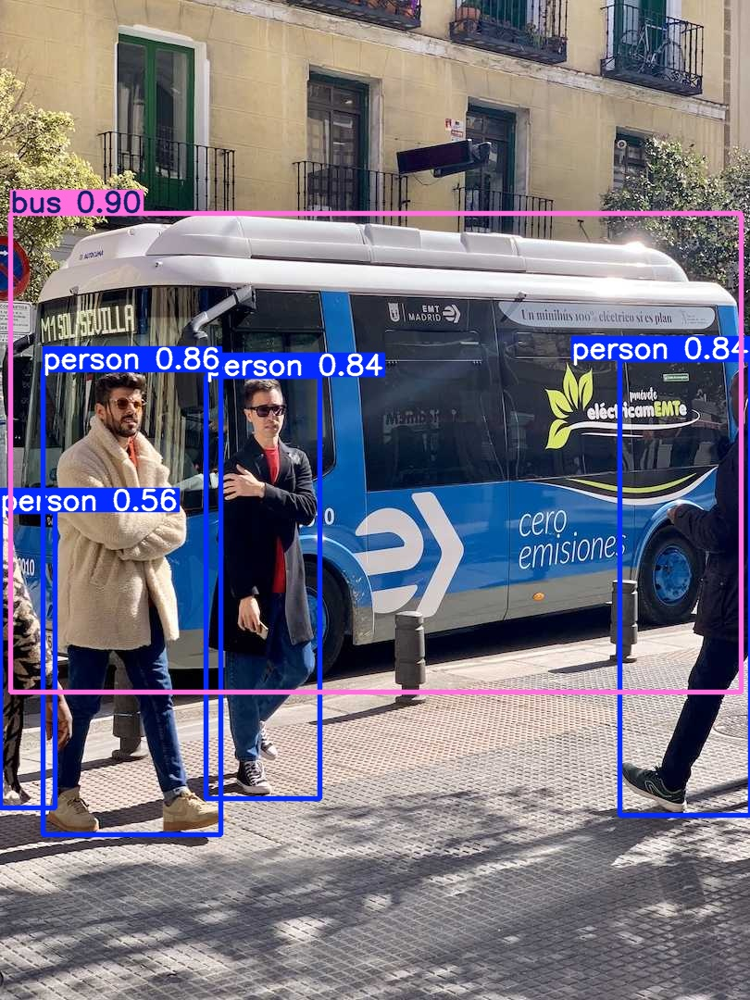

**Webcam image and person detection**

| Original camera capture | YOLO detection |
| --- | --- |
| 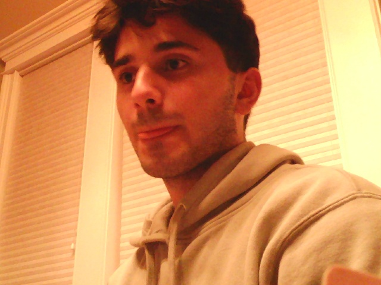 | 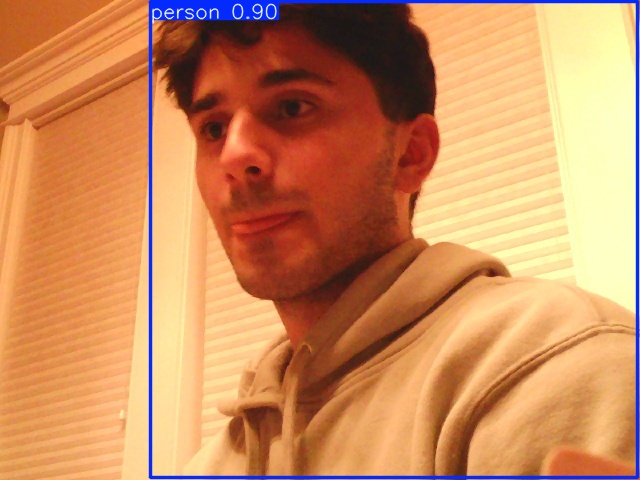 |

The detector reported approximately 65 ms inference time for the webcam still image. This is a single-image measurement, not a sustained real-time frame-rate benchmark.

## Part B: Recognize people with YOLO

I used the supplied YOLO tools to detect people in a webcam image and reviewed the resulting bounding box and confidence. I also examined the available real-time person detector and its confidence and headless options. The saved image demonstrates successful person recognition; I have not included evidence of a separate live `yolo_person.py` VNC session, so I do not claim that interactive demo was completed.

The confidence threshold matters because a lower threshold can retain uncertain detections, while a higher threshold may omit partially visible people. This tradeoff is especially important in a monitoring application: one missed frame should not automatically be treated as a confirmed departure.

## Part C: Hand and pose tracking with MediaPipe

I completed the provided `hand_pose.py` demonstration using the Raspberry Pi's desktop through RealVNC Connect and the Pi's WayVNC server. Running the program through a normal SSH session initially failed because OpenCV could not connect to a graphical display (`qt.qpa.xcb: could not connect to display`). Connecting through VNC resolved this, and the live webcam window displayed the MediaPipe hand skeleton and interactive percentage indicator.

I tested the hand landmark tracking by raising my hand, spreading my fingers, and changing the distance between my thumb and index finger. The application tracked the 21 hand landmarks and displayed a changing percentage indicator. The demonstration also includes a gesture-based immediate control; the recorded evidence establishes the live hand tracking and percentage visualization, rather than a separately verified audio-mute outcome.

**Part C demonstration:** [Watch the hand-pose interaction video](media/hand_pose/Lab5A_PartC_Hand_Pose_Demonstration.mp4)

**Implementation:** [View `hand_pose.py`](hand_pose.py) · [View `loop_audio.sh`](loop_audio.sh)

This shows how a set of landmark coordinates can become an interface: a continuous measurement such as fingertip distance can control a value, while a recognizable pose can trigger a discrete event. For an overnight observant system, I could use a deliberate hand gesture to begin monitoring at bedtime, with a visible acknowledgment to avoid accidental activation. A morning gesture could dismiss or replay the summary.

## Part D: Run Qwen locally with Ollama

I installed Ollama and downloaded two models:

- `qwen3.5:0.8b` (approximately 1.3 GB), supporting text and image input.
- `qwen3:0.6b` (approximately 522 MB), a smaller text-only model.

The `ollama list` output confirmed both models were installed. I ran the larger model interactively with `/set nothink`, then used `ask_qwen.py` to compare the models on the same prompt and to test image understanding.

### Experimental results

| Test | Model | Time | Observation |
| --- | --- | ---: | --- |
| History of Roosevelt Island | Qwen3.5 0.8B | 16.4 s | Generated a plausible but historically inaccurate explanation |
| Same history prompt | Qwen3 0.6B | 5.8 s | Responded faster but also included inaccurate historical claims |
| Describe `snap.jpg` | Qwen3.5 0.8B | 33.8 s | Described the visible person and window blinds broadly correctly |

The smaller model was approximately 2.8 times faster for this one text prompt, but the comparison is not a general benchmark. Both models demonstrated that fluent output is not necessarily accurate. The image-capable model could interpret a photo but required substantially longer than the text-only queries.

### Qwen evidence

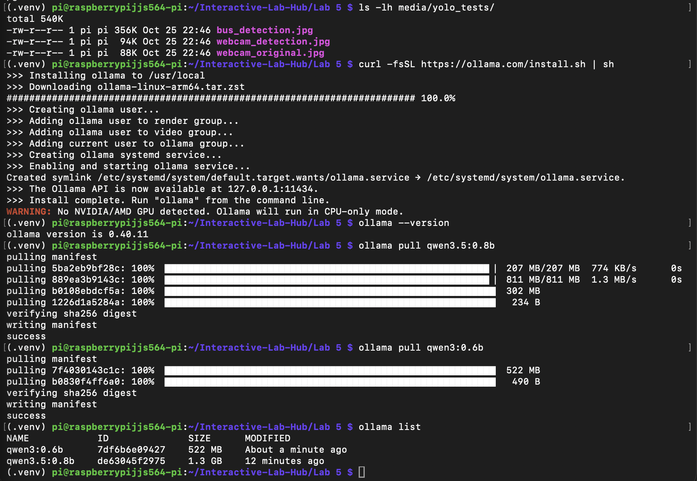

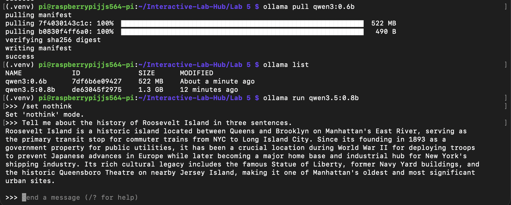

The terminal-based tests and timing observations are also documented in [Part D experiment notes](media/hand_pose/qwen_tests/qwen_part_d_results.md).

## Part E: Connect YOLO observations to Qwen reasoning

I ran `yolo_to_qwen.py --headless` over SSH. The script used the USB webcam to detect people, converted detections into compact descriptions, logged changes to `watch_log.txt`, and asked Qwen to summarize the resulting observations. Headless mode was useful because the terminal session did not provide the graphical window required by the VNC version.

### System pipeline

```text
USB webcam
    |
    v
YOLO26n object detection
    |
    v
Interpreter: person count + left/center/right + close/far
    |
    v
Time-stamped observation log (watch_log.txt)
    |
    v
Qwen reasoning from the text log
    |
    v
Natural-language summary
```

This separation is central to the design. The detector finds visual objects, the interpreter chooses which facts to preserve, and the language model attempts to explain the sequence. The language model does not directly see the video in this pipeline.

### Run 1: Movement while remaining in view

I remained in the camera's field of view and made several movements. The script saved **six observations**, usually detecting one person at `center/close` or `right/close`. One observation reported two people, although I was the only intended participant, suggesting a possible false positive. Qwen responded in **8.8 seconds** but incorrectly stated that three people were present and that one remained stationary throughout the recording.

### Run 2: Entering and leaving the camera view

I repeated the test with deliberate changes in visibility. The system saved **15 observations**, alternating between `1 person` and `nobody`, and occasionally changing the detected position. Qwen responded in **24.6 seconds**, but claimed there were five people and that almost nothing changed. Those statements contradicted the log.

| Observation | Run 1 | Run 2 |
| --- | --- | --- |
| Logged lines | 6 | 15 |
| Detected behavior | Position changes, mostly one person | Repeated presence/absence and position changes |
| Qwen response time | 8.8 s | 24.6 s |
| Main limitation | Invented people and stationary behavior | Invented five people and overlooked repeated changes |

The second run produced more informative **sensor evidence**, even though its Qwen summary was less reliable. These results should not be interpreted as a measurement of YOLO's overall accuracy because I did not record a synchronized ground-truth video for every detection.

**Saved observation logs:**

- [Run 1 log](media/hand_pose/yolo_qwen_tests/Lab5A_YOLO_Qwen_Observation_Log.txt)
- [Run 2 log](media/hand_pose/yolo_qwen_tests/Lab5A_YOLO_Qwen_Run2_Log.txt)

### What I learned

The YOLO-to-Qwen pipeline worked end to end, but **the final summary cannot be treated as ground truth**. A reliable version should compute basic quantities such as maximum simultaneous person count and number of presence/absence transitions directly from the log. Qwen should then be instructed to summarize only those verified facts and to state uncertainty where observations are incomplete.

The `center/close` and `right/close` labels also describe the position of a detected bounding box, not a confirmed identity or a precise physical location. The hand movements I made in Run 1 were not independently identified because this interpreter does not use hand landmarks.

## Reflection and next steps

The most successful part of Lab 5a was running a complete, local observation pipeline on the Raspberry Pi: camera capture, object detection, interpretation, event logging, and language-model output. The experiments also exposed a clear failure mode: Qwen sometimes inferred people or events that the detector never logged.

For Lab 5b, I plan to use this insight to design an overnight interaction that treats recorded observations as evidence. The bedtime interaction should establish what to monitor, the overnight process should log meaningful events without needing constant attention, and the morning output should provide a short, factual summary. Privacy, camera placement, detection uncertainty, and the possibility of false alarms will be important design constraints.

## Files and reproducibility

The supplied lab scripts are available in this `Lab 5` directory. The files used or examined for Part 1 include [snap.py](snap.py), [yolo_person.py](yolo_person.py), [hand_pose.py](hand_pose.py), [loop_audio.sh](loop_audio.sh), [ask_qwen.py](ask_qwen.py), and [yolo_to_qwen.py](yolo_to_qwen.py). The starter scripts for Part 2, [overnight.py](overnight.py) and [morning.py](morning.py), are also present. Supporting evidence is organized in [YOLO tests](media/hand_pose/yolo_tests/), [Qwen tests](media/hand_pose/qwen_tests/), [YOLO-to-Qwen tests](media/hand_pose/yolo_qwen_tests/), and [hand-pose demonstration](media/hand_pose/).

Representative commands used:

```bash
cd ~/Interactive-Lab-Hub/"Lab 5"
source .venv/bin/activate

# Capture and detect a person in a still image
python snap.py --delay 3
yolo predict model=yolo26n_ncnn_model source=snap.jpg project=runs

# Inspect locally installed Qwen models
ollama list

# Compare text and image reasoning
python ask_qwen.py "Tell me about the history of Roosevelt Island in three sentences."
python ask_qwen.py --model qwen3:0.6b "Tell me about the history of Roosevelt Island in three sentences."
python ask_qwen.py --image snap.jpg "What is in this photo?"

# Observe, log, and summarize camera detections
python yolo_to_qwen.py --headless

# Run the graphical hand-pose demonstration in the Pi desktop via VNC
chmod +x loop_audio.sh
python hand_pose.py
```

## Collaboration and AI acknowledgment

This lab was completed individually. I used ChatGPT to help interpret terminal output, troubleshoot setup, VNC access, video conversion and file handling, organize experiment evidence, and edit the documentation. I executed the commands, captured the webcam tests, and reviewed the actual observations and model responses. AI-generated interpretations were checked against the saved logs rather than accepted as factual evidence.

---

<details>
<summary><strong>Original Lab 5 Part 1 instructions (click to expand)</strong></summary>

# Observant Systems: Overnight Sensation

**Team:**

**Members:** Full Name (netid, github-handle), ...

**Project name:**

<details>
	<summary><strong>Instructions for Students (Click to Expand)</strong></summary>
  
	**Submission Cleanup Reminder:**
	- This README.md contains extra instructional text for guidance.
	- Before submitting, remove all instructional text and example prompts from this file.
	- You may delete these sections or use the toggle/hide feature in VS Code to collapse them for a cleaner look.
	- Your final submission should be neat, focused on your own work, and easy to read for grading.
  
	This helps ensure your README.md is clear, professional, and uniquely yours!
</details>


For lab this week, we focus on creating interactive systems that can detect and respond to events or stimuli in the environment of the Pi, like the Boat Detector we mentioned in lecture. 
Your **observant device** could, for example, count items, find objects, recognize an event or continuously monitor a room.

This lab will help you think through the design of observant systems, particularly corner cases that the algorithms need to be aware of.

**New this year: the AI runs on the Pi.** Your Pi 5 can run an object detector ([YOLO](https://docs.ultralytics.com/)) and a small language model ([Qwen](https://ollama.com/library/qwen3.5) through [Ollama](https://ollama.com)) completely offline. In Part 1 you get both running and connect them: YOLO *sees*, Qwen *reasons* about what was seen. These models are slow, but they have all night. In Part 2 you use them to design a **night-time interaction**: what you tell the device before bed, what it does while you sleep, and what it shows you when you wake up.

**Please indicate anyone that helped with this Lab here.**
Be generous in acknowledging their contributions! And also recognizing any other influences (e.g. from YouTube, Github, Twitter) that informed your design. 

## Overview

**Part 1: the tools**

A) [Set up your Pi for on-device AI](#part-a)

B) [See: recognize people in real time with YOLO](#part-b)

C) [See more: hands and pose with MediaPipe](#part-c)

D) [Reason: run Qwen on the Pi with Ollama](#part-d)

E) [Connect: from YOLO readings to Qwen reasoning](#part-e)

**Part 2: Overnight Sensation**

F) [Read Part 2 and storyboard your night-time interaction](#part-f)

G) [Design the interaction before bed](#part-g)

H) [Incorporate the observant system during sleep](#part-h)

I) [Design the interaction when awake](#part-i)

The tools from earlier versions of this lab (MobileNet, Teachable Machine, Moondream, audio analysis, classic OpenCV) live in the [legacy folder](legacy/README.md). They are optional, but any of them can be the sensor in your Part 2 system.


## Prep for Part 1

Please check the instructions in [prep.md](prep.md) and complete them before lab. The installs in Part A take a while, so prep.md also tells you how to get a head start.

## The Report

This readme.md page in your own repository should be edited to include the work you have done. You can delete everything but the headers and the sections between the \*\*\***stars**\*\*\*. Write the answers to the questions under the starred sentences. Include any material that explains what you did in this lab hub folder, and link it in the readme.

---

# Part 1

## Part A. 
### Set up your Pi for on-device AI

Create a virtual environment and install the requirements. They include `ultralytics` (YOLO), which pulls in torch, so this takes a while:

```
pi@raspberrypi:~$ cd Interactive-Lab-Hub/Lab\ 5
pi@raspberrypi:~/Interactive-Lab-Hub/Lab 5 $ python3 -m venv .venv
pi@raspberrypi:~/Interactive-Lab-Hub/Lab 5 $ source .venv/bin/activate
(.venv) pi@raspberrypi:~/Interactive-Lab-Hub/Lab 5 $ pip install -r requirements.txt
```

As in Lab 3, [`uv`](https://docs.astral.sh/uv/) is a much faster drop-in for `pip`: `pip install uv && uv pip install -r requirements.txt`.

### YOLO: download the nano model and export it for the Pi

We use the nano model of [YOLO26](https://docs.ultralytics.com/models/yolo26/), exported once to NCNN, the format that runs fastest on the Pi. This downloads the weights:

```
(.venv) pi@raspberrypi:~/Interactive-Lab-Hub/Lab 5 $ python -c "from ultralytics import YOLO; YOLO('yolo26n.pt').export(format='ncnn')"
(.venv) pi@raspberrypi:~/Interactive-Lab-Hub/Lab 5 $ yolo export model=yolo26n.pt format=ncnn
```
If every ultralytics message is followed by a `--- Logging error ---` traceback ending in `UnicodeEncodeError: 'latin-1' codec can't encode character`, fix your shell's locale once::

```
echo 'export LANG=C.UTF-8' >> ~/.bashrc
echo 'export LC_ALL=C.UTF-8' >> ~/.bashrc
echo 'export PYTHONIOENCODING=utf-8' >> ~/.bashrc
source ~/.bashrc
```

The second command converts the .pt model to a .ncnn model.

Test it on an image from the internet. `project="$PWD"` keeps the output in `predict` in the current lab folder; without it, ultralytics writes to a `runs/` folder at the top of your git repo, where you will not think to look.

```
(.venv) pi@raspberrypi:~/Interactive-Lab-Hub/Lab 5 $ yolo predict model=yolo26n_ncnn_model source=https://ultralytics.com/images/bus.jpg project="$PWD"
```

The result is in `predict/bus.jpg`: boxes around the people and the bus.

Now a photo of your own. Plug in the webcam and take one with `snap.py` (`--delay 3` gives you three seconds to get into the frame), or choose any picture you downloaded from the internet and put under this folder. Put your selected picture after the `source=` Then run the same command on it:

```
(.venv) pi@raspberrypi:~/Interactive-Lab-Hub/Lab 5 $ python snap.py --delay 3
(.venv) pi@raspberrypi:~/Interactive-Lab-Hub/Lab 5 $ yolo predict model=yolo26n_ncnn_model source=snap.jpg project=runs
```

Every run gets its own numbered folder, so this one is in `runs/predict2/snap.jpg`; the command prints where it saved. Keep `snap.jpg`, you will show it to Qwen in Part D.

### Ollama: install it and pull Qwen

[Ollama](https://ollama.com) runs language models locally. Nothing leaves the Pi: no API key, no internet after the download.

```
pi@raspberrypi:~ $ curl -fsSL https://ollama.com/install.sh | sh
pi@raspberrypi:~ $ ollama pull qwen3.5:0.8b
pi@raspberrypi:~ $ ollama pull qwen3:0.6b
pi@raspberrypi:~ $ ollama list
```

| model | download | what it does |
|---|---|---|
| `qwen3.5:0.8b` | ~1.3 GB | text **and images**; the one we use in this lab |
| `qwen3:0.6b` | ~0.5 GB | text only, smaller and faster (~16 tokens/s on a Pi 5) |

\*\*\***Include a screenshot of `ollama list` showing your models.**\*\*\*


## Part B. 
### See: recognize people in real time with YOLO

YOLO is an *object detector*: it finds every person, cup, cat and so on (the 80 [COCO](https://cocodataset.org/) classes), draws a box around each, and gives a confidence. For an observant system that is exactly what you want: *how many*, *where*, *how sure*.

Connect your webcam, connect to your Pi through **VNC** (the script opens a window), and run the person detector. Read `yolo_person.py` first; the loop at the bottom is the whole idea.

```
(.venv) pi@raspberrypi:~/Interactive-Lab-Hub/Lab 5 $ python yolo_person.py
```

While it runs, walk in and out of the frame, sit down, turn your back, hold up a photo of a person on your phone. Watch the confidence number on the box change with each.

Then press q to quit and run it again with a flag. Each one changes a single thing:

```
(.venv) pi@raspberrypi:~/Interactive-Lab-Hub/Lab 5 $ python yolo_person.py --conf 0.2     # lower the bar: see what the model is unsure about
(.venv) pi@raspberrypi:~/Interactive-Lab-Hub/Lab 5 $ python yolo_person.py --conf 0.7     # raise the bar: see what you lose
(.venv) pi@raspberrypi:~/Interactive-Lab-Hub/Lab 5 $ python yolo_person.py --all          # all 80 classes, not only people: what else is on your desk, and what does it get wrong?
(.venv) pi@raspberrypi:~/Interactive-Lab-Hub/Lab 5 $ python yolo_person.py --headless     # no window, only the printed readings: how it runs over ssh, and at night
```

\*\*\***Include a short video or screenshots of your experiments with the person detection. Write down three situations where it did not see you, or saw a person who was not there, and what you think the cause was.**\*\*\*


## Part C. 
### See more: hands and pose with MediaPipe

YOLO tells you that a person is there. Google's [MediaPipe](https://mediapipe.dev/) tells you what their hands and body are doing: face, hand and body pose detection, fast on the Pi.


The demo plays a looping audio file, so make the helper script executable first:

```
(.venv) pi@raspberrypi:~/Interactive-Lab-Hub/Lab 5 $ chmod +x loop_audio.sh
```

Connect your webcam, connect to your Pi through **VNC**, and run the hand pose script:
(***it will not work if you use ssh from your laptop***)

```
(.venv) pi@raspberrypi:~/Interactive-Lab-Hub/Lab 5 $ python hand_pose.py
```

Try the two main features of this script: 1) pinching for percentage control (the thumb-to-index distance sets the volume), and 2) "[Quiet Coyote](https://www.youtube.com/watch?v=qsKlNVpY7zg)" for instant percentage setting (the gesture mutes it). Notice how this example uses hardcoded positions and relates those positions with a desired set of events, in `hand_pose.py`: a hand is 21 landmark coordinates, and an *event* is a rule you write over them. That is the same job as `interpret()` in Part E.

Consider how you might use this position based approach to create an interaction, and write how you might use it on either face, hand or body pose tracking.

\*\*\***Include a screenshot or short video of the hand pose demo, and write how you might use face, hand or body pose tracking in your observant system.**\*\*\*


## Part D. 
### Reason: run Qwen on the Pi with Ollama

Talk to the model in the terminal first. Qwen3 models "think" before they answer, which is slow on a Pi, so turn it off. Then ask about something you can check:

```
pi@raspberrypi:~ $ ollama run qwen3.5:0.8b
>>> /set nothink
>>> Tell me a bit about the history of Roosevelt Island. Three sentences.
>>> /bye
```

Roosevelt Island is a good first question because you know the ground truth: it was Blackwell's Island, then Welfare Island, got its current name in 1973, and Cornell Tech opened on it in 2017. Count how many of the model's facts are true.

From Python, qwen requests can be triggered by the `ask_qwen.py` script. It turns thinking off, tells the model to answer in at most three sentences, and cuts it off after 120 tokens (`--max-tokens` changes that), because a small model left alone writes an essay. Read the script, then run:

```
(.venv) pi@raspberrypi:~/Interactive-Lab-Hub/Lab 5 $ python ask_qwen.py "Tell me a bit about the history of Roosevelt Island."
(.venv) pi@raspberrypi:~/Interactive-Lab-Hub/Lab 5 $ python ask_qwen.py --model qwen3:0.6b "Tell me a bit about the history of Roosevelt Island."
(.venv) pi@raspberrypi:~/Interactive-Lab-Hub/Lab 5 $ python ask_qwen.py --image snap.jpg "What is in this photo?"
```

Things in the [Ollama API](https://github.com/ollama/ollama/blob/main/docs/api.md) worth knowing:

* `think: false` skips the reasoning trace. Always, on a Pi. `ask_qwen.py` sends it on every request; `--think` turns the trace back on for one question, so you can see what you are skipping and how long it takes.
* `format` makes the model answer as JSON with the fields you name (`--json`). Handy when a display or a servo has to read the answer.
* `images` sends a photo along with the prompt (`--image snap.jpg`, the photo from Part A). `qwen3.5:0.8b` can look at pictures.

A 0.8B model is slow and sometimes wrong. It will invent events that are not in the data and agree with a wrong premise. Give it the data, keep its job narrow, and decide what the device does when the model is unsure.

\*\*\***Ask Qwen three questions to answer. Paste the questions, the answers and how long each took. Try one of them with `qwen3:0.6b` and compare.**\*\*\*

<details>
  Q&A here
</details>


## Part E. 
### Connect: from YOLO readings to Qwen reasoning

An observant system is a pipeline: a **detector** turns pixels into boxes, an **interpreter** turns boxes into readings in words ("one person, left, close"), the readings pile up in a **log**, and a **reasoner** answers a question about the log. The language model never sees pixels, only the words you chose in the interpreter. That makes the interpreter the most important design decision in the system.

`yolo_to_qwen.py` is the pipeline in one file, one function per stage. Read it before you run it:

* `interpret(r)` is the interpreter. It takes one YOLO result and returns one reading. A person is *left*, *center* or *right* by which third of the frame the middle of their box is in, and *close* if the box is taller than 60% of the frame, *far* otherwise. The reading is a string like `1 person(s) at center/close`, or `nobody`. Fifteen lines, and they decide everything the model can know.
* `watch(seconds)` is the detector and the log. Twice a second it reads a frame, runs YOLO on it and calls `interpret()`. A time-stamped reading goes into the log **only when it differs from the previous one**, so a minute of sitting still is one line, not 120.
* `ask(log, question)` is the reasoner. It pastes the log and your question into one prompt, tells Qwen to answer in at most three sentences using only what is in the log, and sends it to Ollama with thinking off.

Run it through VNC and a window opens with YOLO's boxes, the current reading and the seconds left. Press q to stop watching early. Over plain ssh add `--headless` and you get the same thing minus the window.

```
(.venv) pi@raspberrypi:~/Interactive-Lab-Hub/Lab 5 $ python yolo_to_qwen.py
```

It watches for a minute, saves the log to `watch_log.txt` and asks Qwen the default question. The terminal looks something like this:

```
14:02:11 nobody
14:02:19 1 person(s) at right/far
14:02:24 1 person(s) at center/close
14:02:51 nobody

4 lines saved to watch_log.txt
asking Qwen...

Qwen (18.4 s):
One person came in from the right, moved close to the camera, and left after about half a minute. ...
```
</details>

---


---


# Lab 5B: Daybreak | An Overnight Physical Interaction

## Project Overview

**Daybreak** is a Raspberry Pi-based interactive system designed around a simple daily transition: going to sleep and waking up to natural daylight.

Rather than relying on a conventional alarm or asking the user to check the time, Daybreak observes the changing brightness outside a window and uses that information to create a meaningful morning interaction. The user initiates the experience at bedtime, leaves the Raspberry Pi operating independently overnight, and returns in the morning to hear a spoken report about when sustained daylight was first detected.

The final prototype combines a USB camera, Raspberry Pi, speaker, Python software, and time-stamped observations. It also captures a photograph of the first confirmed daylight event, creating a visual record of what the system observed.

The goal was not simply to detect a bright image. It was to explore how an interactive device could interpret a gradual environmental change, distinguish a sustained event from temporary fluctuations, and communicate that observation back to a person.

---

## 1. Interaction Concept

Daybreak is organized around two complementary interactions.

### Bedtime Handoff

At night, the user starts Daybreak and receives a verbal acknowledgment that the system is beginning its observation.

The camera faces a window while the Raspberry Pi monitors brightness at regular intervals. Once the observation begins, the laptop is no longer needed for the ongoing sensing process.

### Morning Reveal

The next morning, the user reconnects to the Raspberry Pi and requests the morning report.

Daybreak reads the stored overnight results and communicates:

- When sustained brightness was first detected
- When that event was confirmed
- How many observations were recorded
- Where the associated photograph was saved

The morning interaction turns a long, mostly invisible sensing process into a concise and understandable report.

### Interaction Flow

```text
USER
  |
  | Starts Daybreak at bedtime
  v
RASPBERRY PI + SPEAKER
  |
  | Verbal acknowledgment
  | "Daybreak is now observing"
  v
WINDOW-FACING CAMERA
  |
  | Captures images periodically
  | Measures image brightness
  v
DAYLIGHT DETECTION
  |
  | Establishes nighttime baseline
  | Checks for brightness increase
  | Requires consecutive qualifying samples
  v
EVENT RECORDING
  |
  | Saves detection and confirmation times
  | Captures daylight photograph
  | Preserves observation log
  v
MORNING REVEAL
  |
  | User requests report
  v
SPOKEN SUMMARY + CAPTURED IMAGE
```

---

## 2. Physical Prototype | Looks Like

The final physical setup used a Raspberry Pi with a camera pointed toward a window and a connected speaker for verbal feedback.

I positioned the camera to observe the outdoor environment through the same window used during calibration and controlled testing. I also kept the laptop closed during the independent overnight observation to demonstrate that the sensing process did not require an active laptop connection.

### Final Overnight Hardware Setup

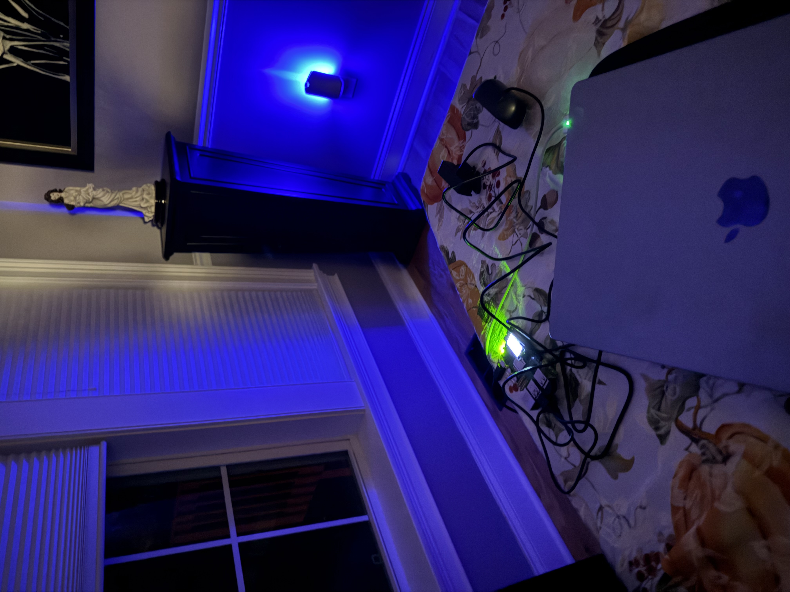

*Figure 1. The overnight arrangement showing the Raspberry Pi, window-facing camera, speaker, and closed laptop.*

### First Sustained Daylight Capture

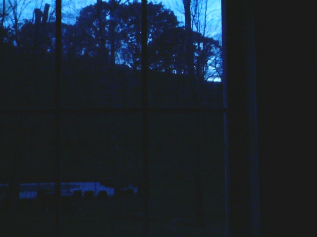

*Figure 2. The photograph captured during the real overnight observation. The blue morning sky is visible through the window, with darker trees and foreground objects remaining in silhouette.*

This photograph is especially meaningful because it represents the environmental event that the device was designed to identify. The image shows an early-morning lighting condition rather than full daylight, which is consistent with the intended behavior of detecting the transition from darkness toward morning.

### Earlier Controlled Capture

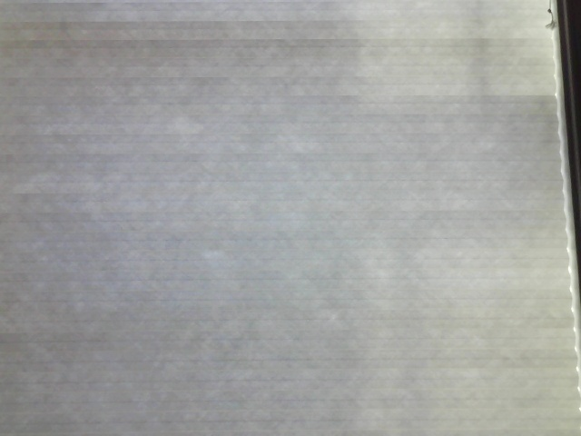

*Figure 3. An earlier controlled test used to validate image capture and the event-recording workflow before the real overnight run.*

---

## 3. Hardware and Software | Works Like

### Hardware

| Component | Purpose |
|---|---|
| Raspberry Pi | Runs the sensing and interaction software independently |
| USB camera | Observes the window and captures images |
| Speaker | Provides spoken bedtime and morning feedback |
| Audio input | Connected to the Raspberry Pi as an available interaction capability |
| Window-facing placement | Provides access to changing outdoor light |
| Power supply | Keeps the Raspberry Pi operating without the laptop |

Although an audio input was connected, the demonstrated Daybreak interaction used the camera as its primary sensor and the speaker as its primary feedback device.

### Software

The system was developed in Python, with OpenCV used to access the camera and process images.

The implementation is separated into three main scripts:

**1. Bedtime entry point**

[View daybreak_start.py](daybreak_start.py)

Starts the bedtime handoff, acknowledges the beginning of the observation, and launches the overnight monitoring process.

**2. Overnight observation**

[View daybreak_overnight.py](daybreak_overnight.py)

Captures camera frames at a specified interval, calculates image brightness, establishes a nighttime baseline, checks for sustained brightness increases, and saves observation results.

**3. Morning report**

[View daybreak_morning.py](daybreak_morning.py)

Reads the saved event information and presents the morning report, with an option for spoken output.

### Detection Method

Daybreak uses the average grayscale brightness of camera frames as a simple measure of environmental light.

The observation process:

1. Captures initial frames to establish a nighttime brightness baseline.
2. Continues sampling the camera at regular intervals.
3. Compares new brightness measurements against the baseline.
4. Checks whether the brightness increase exceeds the selected threshold.
5. Requires multiple consecutive qualifying samples before confirming an event.
6. Records the event time and saves an associated photograph.

Requiring consecutive qualifying measurements helps prevent the system from treating a single brief brightness fluctuation as sustained daylight.

This is a deliberately simple computer vision approach. It does not use a trained sunrise classifier or directly measure physical illuminance in lux.

---

## 4. Development and Testing Process

I developed and tested Daybreak incrementally rather than immediately attempting a full overnight observation.

### Test 1: Camera and OpenCV Validation

I first verified that the Raspberry Pi could access the connected camera through OpenCV.

The camera successfully opened and returned a frame at a resolution of 640 × 480 pixels. I also verified that the system could calculate average grayscale brightness and save a captured image.

This established that the camera and image-processing environment were functioning before integrating the full overnight workflow.

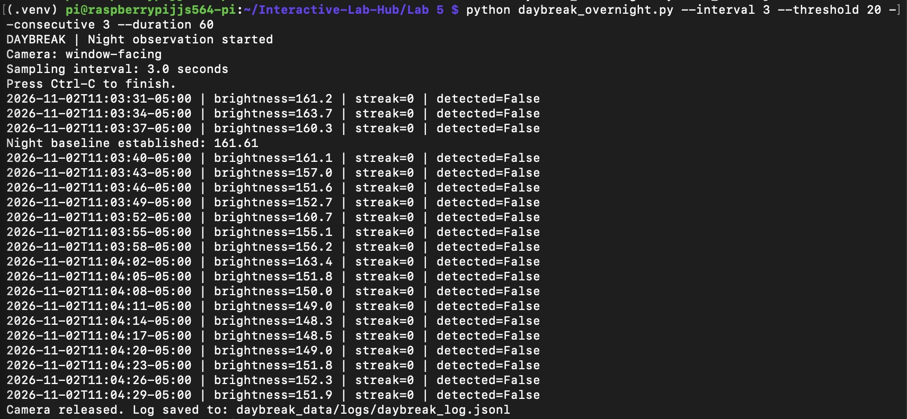

### Test 2: Controlled Brightness Detection

I then used a controlled window and curtain demonstration to test the detection logic without waiting for an actual sunrise.

The system recorded brightness samples, established a baseline, and evaluated whether the measured brightness increased sufficiently for the required number of consecutive observations.

An initial test used a threshold increase of 20 brightness units and did not detect a sustained event. A subsequent test lowered the threshold increase to 8 units and successfully exercised the detection workflow.

During the successful controlled test, the software generated an event record and saved a photograph.

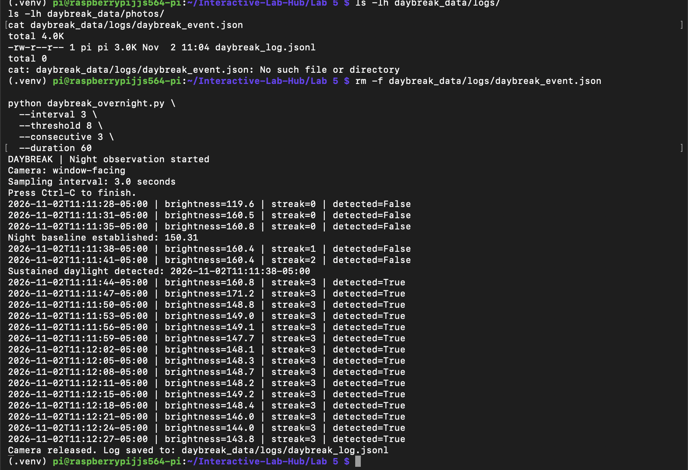

The controlled test confirmed that the sensing, event-recording, and photograph-saving pipeline could operate together.

### Test 3: Morning Report and Audio Output

After verifying the observation pipeline, I tested the morning report independently.

The script successfully retrieved a stored event and reported its detection time, confirmation time, sample count, and photograph location.

I then tested the spoken version using the connected speaker. The audio output worked, demonstrating that the sensing results could be communicated through sound rather than requiring the user to inspect the log manually.

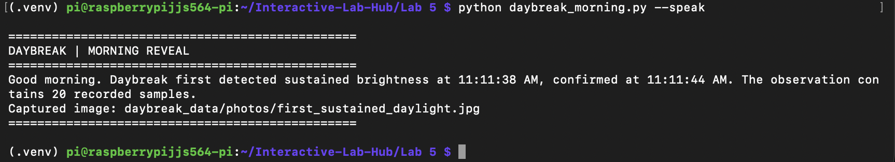

### Test 4: Bedtime Handoff

I added a bedtime entry point that provides an acknowledgment before starting the observation process.

This was important for the interaction design because the user needs confirmation that the device has accepted the request and begun monitoring.

The handoff and observation process were tested together before the final overnight deployment.

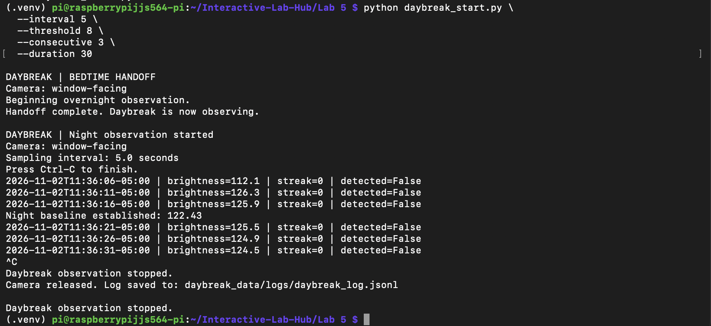

---

## 5. A Critical Discovery: Artificial Light and the Nighttime Baseline

One of the most important findings occurred during preparation for the real overnight observation.

### Initial Overnight Attempt

During the first nighttime attempt, the room lights were still on while the camera faced the window.

The system established a baseline of approximately **81.85 grayscale brightness units**.

Because the detection threshold was set to an increase of 8 units, subsequent measurements near 93 were sufficient to trigger the detection logic.

The system therefore reported sustained daylight at approximately 2:53 AM, even though the intended environmental event had not occurred.

This was a false positive.

The issue was not that the code failed to execute. Rather, the brightness-based detection method responded to lighting conditions that did not represent actual daylight.

### Why This Happened

The camera was facing a window, but the image could still be influenced by light originating inside the room.

Indoor lighting may affect the image through reflections, illuminated foreground objects, or the camera's automatic exposure and gain adjustments.

The exact contribution of these factors was not measured independently, so I cannot attribute the false detection to one specific camera setting.

However, the experiment demonstrated that the camera's brightness measurements were sensitive to the physical lighting environment, not only the outdoor sky.

### Revised Overnight Setup

To address this, I turned off the room lights and restarted the observation with the camera in the same window-facing position.

This removed a major source of artificial illumination from the scene.

The real overnight observation established a much lower nighttime baseline of **26.92 grayscale brightness units**.

This lower baseline was more representative of the dark environment I wanted Daybreak to observe. It also provided a clearer reference for measuring the transition toward natural morning light.

Importantly, the improvement came from changing the physical setup rather than simply adding more complicated software.

### Design Lesson

This experiment showed that the environment surrounding a sensor is part of the interaction system.

Camera placement, indoor illumination, reflections, and possible automatic camera adjustments can all affect the meaning of a brightness measurement.

For Daybreak, controlling the lighting conditions at bedtime proved essential to making the morning detection more meaningful.

---

## 6. Final Real Overnight Observation

After completing the controlled tests and revising the nighttime setup, I ran Daybreak overnight with the Raspberry Pi powered independently and the camera facing the window.

### Final Run Configuration

| Parameter | Value |
|---|---|
| Camera orientation | Window-facing |
| Sampling interval | 30 seconds |
| Brightness threshold increase | 8 grayscale units |
| Consecutive qualifying samples | 3 |
| Configured observation duration | 32,400 seconds (9 hours) |
| Nighttime brightness baseline | 26.92 |
| Observation date | November 3, 2026 |

The system collected hundreds of time-stamped brightness observations across the night and recorded a confirmed sustained daylight event in the morning.

### Recorded Results

<text>This line is plain Markdown table content for the GitHub README.</text>

| Measurement | Result |
|---|---|
| First sustained daylight detection | **6:11:42 AM EST** |
| Daylight confirmation | **6:12:42 AM EST** |
| Nighttime baseline | **26.92** |
| Threshold increase | **8.0** |
| Required consecutive samples | **3** |
| Recorded samples | Approximately **890** |
| Captured photograph | `first_sustained_daylight.jpg` |

The event record provides the exact timestamps, baseline, threshold, and photograph reference.

### Overnight Evidence

- [View real overnight observation log](media/daybreak/logs/Lab5B_Daybreak_Overnight_Log.jsonl)
- [View real overnight event record](media/daybreak/logs/Lab5B_Daybreak_Overnight_Event.json)
- [View captured daylight photograph](media/daybreak/photos/Lab5B_Daybreak_Overnight_Daylight_Capture.jpg)

### Interpretation

The result was encouraging because the detected event occurred during the early morning and produced a photograph showing a visibly brighter sky above a dark foreground.

The timing was plausible for the particular window orientation and outdoor scene being observed. It also aligned with the visual goal of the prototype: identifying the first sustained increase in morning brightness rather than waiting until the entire scene was brightly illuminated.

The photograph is not a perfect representation of a fully exposed outdoor scene, but that was not the objective. It captures a recognizable transition between nighttime darkness and the beginning of daylight.

This was a successful demonstration of Daybreak's intended interaction, although the event time should be interpreted as a camera-based brightness threshold crossing rather than a verified astronomical sunrise time.

---

## 7. Final Video Demonstrations | Acts Like

The completed interaction is documented in two videos.

### Video 1: Bedtime Handoff

[Watch the Bedtime Handoff Demonstration](media/daybreak/video/Daybreak_Video_Demonstrations.md)

This demonstration shows the start of the experience, including the spoken acknowledgment that Daybreak is beginning its overnight observation.

### Video 2: Morning Reveal

[Watch the Morning Reveal Demonstration](media/daybreak/video/Daybreak_Video_Demonstrations.md)

This demonstration shows the next-morning interaction, when the system retrieves the overnight observation and verbally reports the detected daylight event.

Both Google Drive videos are indexed here:

**[Daybreak | Video Demonstrations](media/daybreak/video/Daybreak_Video_Demonstrations.md)**

Together, the videos demonstrate the complete user experience from bedtime to the morning report.

---

## 8. Reflection

### How did sensing shape the interaction?

The sensing method determined the entire structure of Daybreak.

Because daylight changes gradually, a single image would not provide enough context to distinguish a meaningful transition from an isolated fluctuation.

The system therefore needed a baseline, repeated observations, a threshold, and a requirement for sustained brightness.

These decisions shaped the interaction into an overnight process rather than an immediate response to one sensor reading.

### How did the physical arrangement affect the result?

Physical arrangement was one of the most important variables.

The camera needed a stable view of the window, but the indoor lighting conditions also mattered.

The initial false detection demonstrated that a camera can respond to artificial illumination even when it is intended to observe the outdoor environment.

Turning off the room lights and repeating the observation produced a more appropriate nighttime baseline and a more convincing morning event.

This made the physical setup an essential part of the sensing logic.

### What adjustments were necessary?

Several adjustments were made during development:

- Verified camera access and image capture before running the complete system.
- Tested different brightness thresholds during controlled demonstrations.
- Used consecutive qualifying samples to avoid immediate single-frame detections.
- Added a spoken morning report to make the observation accessible.
- Added a verbal bedtime acknowledgment to confirm the handoff.
- Corrected the Python environment so OpenCV was available when the overnight process launched.
- Used a persistent terminal session to allow the Raspberry Pi to continue operating after the laptop disconnected.
- Removed indoor lighting before the final overnight run to reduce interference.

Each adjustment addressed a practical issue discovered through testing.

### What worked well?

The strongest result was the completed overnight interaction.

Daybreak successfully recorded a sustained brightness event at 6:11:42 AM, confirmed it at 6:12:42 AM, and produced an associated image of the early morning sky.

The morning report also worked with spoken output, allowing the user to hear the result rather than manually interpreting raw measurements.

### What were the limitations?

The main limitation is that average image brightness is an indirect measurement of daylight.

It can be affected by artificial light, reflections, shadows, weather, camera exposure, and changes in the observed scene.

The nighttime baseline was established from a small number of initial samples, making the system sensitive to conditions at the moment observation begins.

The final overnight test demonstrated a plausible daylight detection, but it did not establish performance across multiple nights, weather conditions, or camera placements.

### What would I improve next?

I would explore several improvements:

1. **Region-based brightness measurement:** Analyze only the portion of the image containing the outdoor sky, reducing interference from the window frame and indoor foreground.
2. **Exposure control:** Experiment with fixed camera exposure and gain, where supported, to make brightness measurements more consistent.
3. **Adaptive baseline estimation:** Use a longer nighttime calibration period or a robust rolling baseline.
4. **Repeated overnight testing:** Compare detection results across multiple mornings and lighting conditions.
5. **Hands-free morning interaction:** Extend the audio input to support a spoken request for the morning report.
6. **Automatic morning notification:** Make the recorded event available without requiring a manual SSH connection.

These changes would help transform Daybreak from a working prototype into a more robust daily-use device.

---

## 9. Final Deliverables

### Source Code

- [daybreak_start.py](daybreak_start.py)
- [daybreak_overnight.py](daybreak_overnight.py)
- [daybreak_morning.py](daybreak_morning.py)

### Physical Prototype and Photographs

- [Overnight hardware setup](media/daybreak/photos/Lab5B_Daybreak_Overnight_Hardware_Setup.jpeg)
- [Real overnight daylight capture](media/daybreak/photos/Lab5B_Daybreak_Overnight_Daylight_Capture.jpg)
- [Controlled daylight capture](media/daybreak/photos/Lab5B_Daybreak_Controlled_Daylight_Capture.jpg)

### Overnight Results

- [Overnight observation log](media/daybreak/logs/Lab5B_Daybreak_Overnight_Log.jsonl)
- [Overnight detection event](media/daybreak/logs/Lab5B_Daybreak_Overnight_Event.json)

### Demonstration Videos

- [Bedtime handoff and morning reveal](media/daybreak/video/Daybreak_Video_Demonstrations.md)

### Additional Design Documentation

- [Initial storyboard](media/daybreak/storyboard/Lab5B_Daybreak_Initial_Storyboard.png)
- [Revised storyboard](media/daybreak/storyboard/Lab5B_Daybreak_Revised_Storyboard.png)
- [Storyboard feedback](media/daybreak/storyboard/Lab5B_Daybreak_Storyboard_Feedback.md)

---

## 10. Conclusion

Daybreak began as an exploration of how an interactive device could respond to a slow environmental transition rather than an immediate button press or command.

Through the project, I developed a working camera-based observation system, added verbal feedback, tested the detection logic under controlled conditions, and completed a real overnight run.

The most important lesson was that sensing is inseparable from context. The first nighttime attempt produced a false detection because the camera's measured brightness was influenced by the surrounding lighting environment. After removing the artificial light and restarting the observation, the system established a more appropriate baseline and recorded a plausible early-morning daylight event.

The final photograph, timestamped event, observation log, and spoken morning report demonstrate the complete interaction.

Daybreak ultimately shows how a small interactive device can turn an ordinary environmental change into a personal, understandable experience.

### AI Assistance

I used ChatGPT to assist with Python development, debugging, command-line troubleshooting, experimental planning, and organizing the documentation. I performed the hardware setup, controlled tests, overnight observation, media capture, and evaluation of the results.


---


<details>
<summary><strong>Original Lab 5 Part 2 Instructions (Click to Expand)</strong></summary>

<br>

---

# Lab 5 Part 2: Overnight Sensation

For Part 2, you will use the observant system from Part 1 to design a night-time interaction. On-device AI is slow, so let it work while you sleep. The person meets the device twice: **before bed**, when they hand the night over, and **when awake**, when the device gives something back. In between, the pipeline from Part E runs on its own.

Two flavors, pick one or mix them:

* **Sense all night.** The Pi watches, listens or measures from bedtime until morning and keeps a log.
* **Process all night.** You already have the data (a day of phone photos, a long recording) and the Pi needs hours to get through it.

Two house rules. Sample rather than stream: one look every 5 to 30 seconds is plenty, and it keeps the Pi cool. And keep everything on the Pi: tell the people you live with, point the camera at things rather than at beds, and delete the snapshots after the demo.

## Part F. 
### Read Part 2 and storyboard your night-time interaction

Storyboard a night-time interaction built on your observant system, in three panels:

1. **Before bed.** How does the person hand the night over, and how does the device acknowledge it?
2. **While asleep.** What does the device watch or work through?
3. **When awake.** What is the one thing the person learns, and in what medium?

Stuck? A kitchen that tells you who raided the fridge. A desk that reports whether you actually went to bed. A window that names the quietest hour. A plant that describes its night. Find something better.

Use storyboards and/or [Verplank diagrams](https://ccrma.stanford.edu/courses/250a-fall-2004/IDSketchbok.pdf).

\*\*\***Insert ideas, sketches, Verplank diagrams and storyboards for your night-time interaction here.**\*\*\*

## Prep for Part 2

1. Look at and give feedback on the Part F storyboards.
   **Put the feedback for your ideas here.**
2. [Update your Lab Hub](prep.md#get-the-latest-content) to get the latest content for Part 2.
3. Decide where the device will spend the night and who else lives there. Get their OK before the first run.
4. Revise your storyboard with the feedback and with what you learned in Part E about where the pipeline breaks.

\*\*\***Post your revised storyboard here.**\*\*\*

## Part G. 
### Design the interaction before

The hand-off: the person tells the device what to watch tonight, and the device acknowledges it. Keep it to a thirty-second ritual. A button or a touch (Lab 4), a spoken sentence (Lab 3), a wave or a Quiet Coyote at the camera (Part C). The acknowledgement can be a line on the display, a tone, or an LED that dims rather than lights up. At its simplest, the hand-off just sets the question that the morning will answer.

\*\*\***Describe the interaction before.**\*\*\*

## Part H. 
### Incorporate the observant system

The Part E pipeline becomes the night shift. `overnight.py` runs your `interpret()` from `yolo_to_qwen.py` every few seconds, people only unless you pass `--all`, and writes the readings to `night_log.jsonl`; the reasoning waits for the morning. Start it inside `tmux` so it keeps running after you close your laptop, and stop it with Ctrl-C in the morning:

```
(.venv) pi@raspberrypi:~/Interactive-Lab-Hub/Lab 5 $ tmux new -s night
(.venv) pi@raspberrypi:~/Interactive-Lab-Hub/Lab 5 $ python overnight.py
```

Fake a night first: run it for thirty seconds while you walk around, stop it, and run `morning.py` from Part I. When that looks right, run a real night. If your storyboard needs a sensor rather than the camera, swap in the Lab 4 example code and log its reading the same way.

\*\*\***Screenshots or videos of the running system.**\*\*\*

## Part I. 
### Design the interaction after

The reveal. The night produced a log; the morning turns it into something a half-awake person can take in. `morning.py` is the smallest version: it asks Qwen for a three-sentence report.

```
(.venv) pi@raspberrypi:~/Interactive-Lab-Hub/Lab 5 $ python morning.py
```

Make it yours: show the report on the Mini PiTFT, read it aloud with Piper from Lab 3, plot the night as a timeline, or ask for JSON (`--json`, Part D) and move a servo. Whatever you pick, make sure it is honest about a night in which nothing happened.

## Final documentation

Document all the prototypes and iterations you have designed and worked on. The deliverables for this lab are writings, sketches, photos, and videos that show what your system:

* "Looks like": how the device sits in the room at night, and what it looks like at bedtime and in the morning.
* "Works like": the pipeline from detector to interpreter to log to reasoner, with a real night's data.
* "Acts like": how a person hands the night over and what they get back.

\*\*\***Include a short video of the whole system**\*\*\*

As always, make sure you document contributions and ideas from others (and AI) explicitly in your writeup.

You are permitted (but not required) to work in groups and share a turn in; you are expected to make equal contribution on any group work you do, and N people's group project should look like N times the work of a single person's lab. Make sure the page for the group turn in is linked to your personal Interactive Lab Hub page.

## Deliverables & Submission for Lab 5

For submission, the readme.md page for this lab should be edited to include the work you have done:
* Upload any materials that explain what you did, including your code and night log, into your Lab 5 repository, and link them in your Lab 5 readme.md.
* Labs are due on Sundays, make sure to submit your Lab 5 readme.md to Canvas.

<details>
  <summary><strong>Submission Cleanup Reminder (Click to Expand)</strong></summary>

  **Before submitting your README.md:**
  - This readme.md file has a lot of extra text for guidance.
  - Remove all instructional text and example prompts from this file.
  - You may either delete these sections or use the toggle/hide feature in VS Code to collapse them for a cleaner look.
  - Your final submission should be neat, focused on your own work, and easy to read for grading.
</details>


</details>
